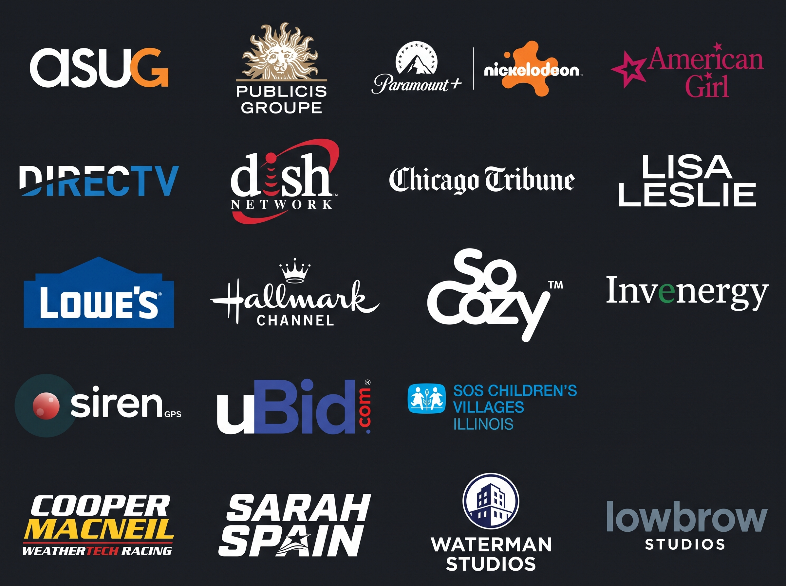

## Hi there 👋

I'm a full-stack creative coder (aka. design engineer) currently looking for full-time remote work.

If you're looking for someone who is into any/all of the following, 
Please feel free to reach out! [X](https://x.com/jakedowns) | [LinkedIn](https://linkedin.com/in/jakedowns)

- AR/VR/MR/XR 
- AI/ML
- Full-Stack Development (Web & Native)
- Shaders / 3D

---

### Notable Experience
- [Cypress Test Helpers for Multi-tab Testing (⭐️47 Stars)](https://github.com/jakedowns/CypressHelpers)
- [Into3D - Open Source Unity + VLC 3D Video Player Android App for XREAL 1K+ downloads in Play Store (⭐️24 Stars)](https://github.com/jakedowns/Nreal-Unity-Demos/releases)
- [Contributed to XReal Open Source Community Drivers Directory (⭐️75+ Stars)](https://github.com/jakedowns/xreal-community-open-source-driver-directory)
- Added LitByLeia LumePad 1, RED Hydrogen One, LumePad 2 Support to Citra 3DS Emulator: [LP1, RH1 (⭐️11 Stars)](https://github.com/jakedowns/citra-4v) | [LP2 (⭐️7 Stars)](https://github.com/jakedowns/citra)
- [Added LitByLeia LumePad 1 + 2 Support to MPV Video Player (⭐️9 Stars)](https://github.com/jakedowns/mpv-android)
- [Added Looking Glass Portrait Support to Citra 3DS Emulator (via ReShade) (⭐️10 Stars)](https://github.com/jakedowns/reshade-shaders)
- [Worked on Auggie Award-winning Mixed Reality Experience: Pillow XR for Meta Quest](https://www.meta.com/experiences/pillow/5655932521164368/) -- Best Consumer App award at the 15th annual Auggie Awards during AWE USA 2024
- [Rago / Wright Auction Group (Full-Stack Dev from 2014-2024: Front-end Responsive SPA, Bespoke CMS White-label Real-time Auction Platform scaled to multiple auction houses)](https://wright20.com)

---

*Previous Clients:*

- ASUG, Publicis Groupe, Paramount (Nickelodeon), Mattel (American Girl), DirecTV, Dish Network, NFL, MLB, Chicago Tribune, Lisa Leslie, Lowe's, Hallmark Channel, SoCozy, Invenergy, SirenGPS, uBid.com, SOS Children's Villages Illinois, Cooper MacNeil (WeatherTech Racing), Sarah Spain, Waterman Studios, Lowbrow Studios

---

I have experience with the following:
- Designing, Developing, Producing, Testing, Shipping, Supporting small, medium & large distributed real-time systems
- Anti-Gravity x Gemini, OpenCode x OpenRouter, Cursor, Co-Pilot, Codex, Grok
- Javascript/HTML/CSS (inc. React, Vue, SASS, tailwind, websockets, you name it)
- PHP/MySQL (Laravel), GraphQL, Roadrunner PHP, Hack/HHVM
- C# + Unity
- Unreal Engine
- Three.js / P5.js
- Blender
- Lua, Python, Java, Kotlin, Rust

---

- Wordpress, Drupal, Code Igniter, Expression Engine, DotNetNuke, ColdFusion, ActionScript 1.0, 2.0, & 3.0, Corona SDK, PhoneGap, Swift, Objective-C
- Ember, Angular, Meteor
- Apple Suite: GarageBand, Logic Pro, Final Cut Pro
- Adobe Suite: Photoshop, Illustrator, InDesign, Premiere After Effects
- Google Suite: Docs, Sheets, Slides
- Microsoft Office Suite: Word, Excel, PowerPoint
- AWS, Rackspace, Dreamhost, GoDaddy
- MacOS, Linux, Windows, Android, iOS
- ci/cd experience, github actions, 
- pivotal tracker, jira, trello, notion, obsidian, monday.com
- slack, discord, teams, google chat, zoom
- Background in School-District level IT Support

---

